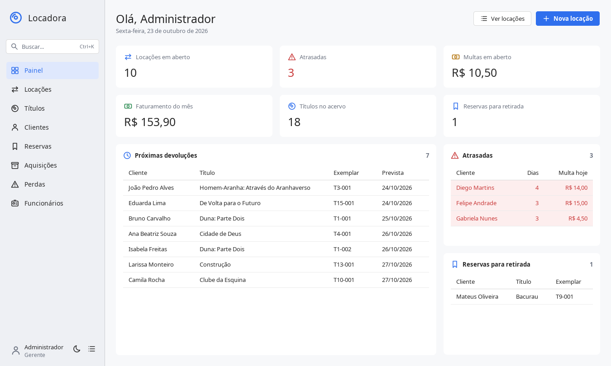
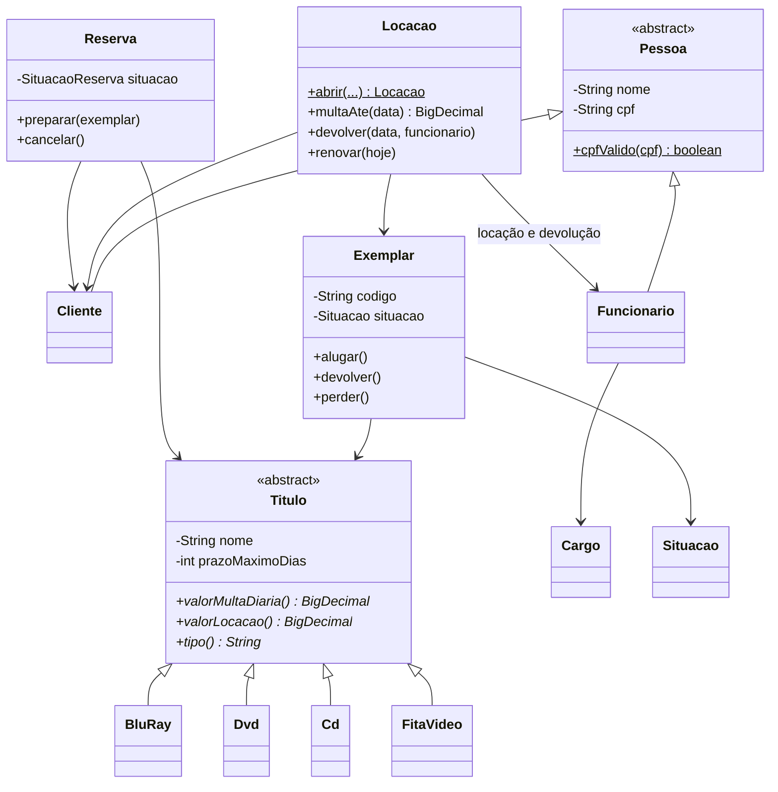
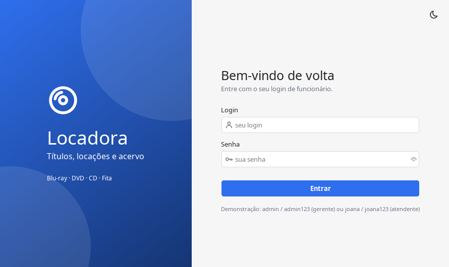
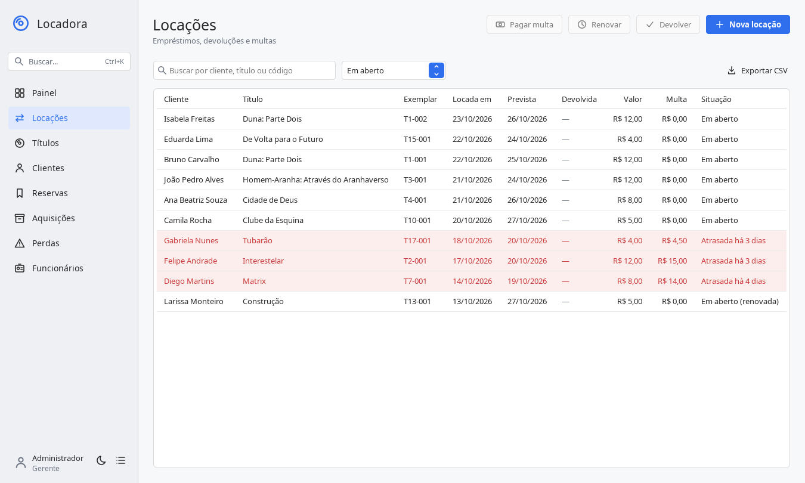
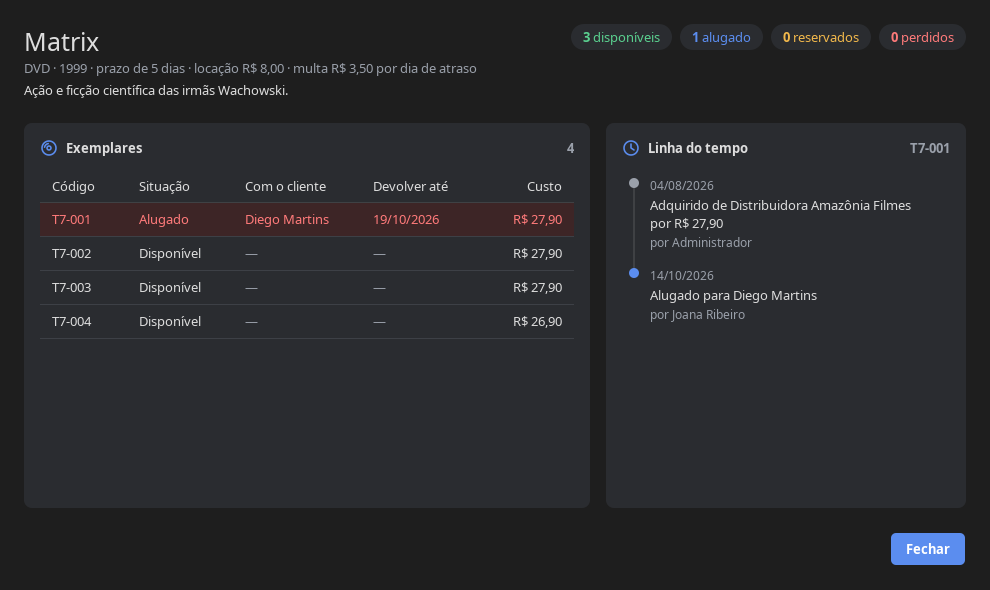
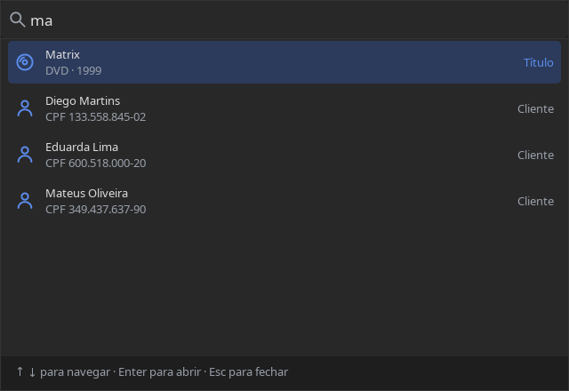
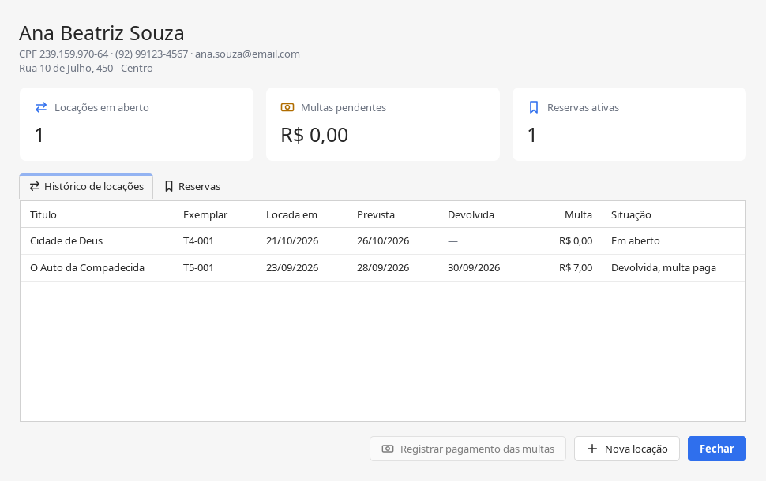
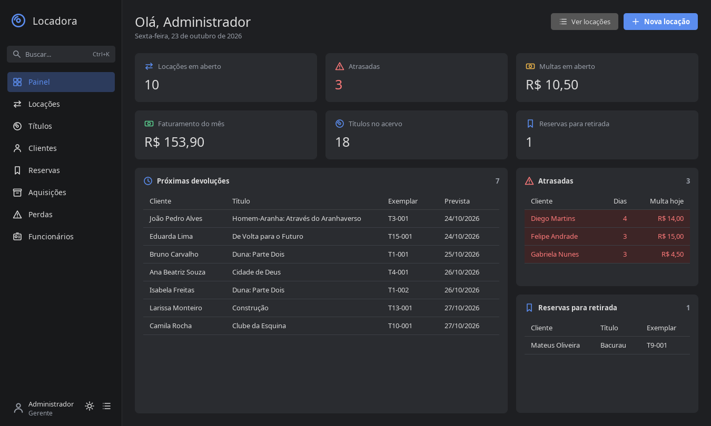

# Locadora — Sistema de Gestão de Locadora


-98%25-brightgreen)

Sistema desktop para a gestão de uma locadora de **Blu-rays, DVDs, CDs e fitas de vídeo**: acervo, clientes,
locações e devoluções com multa, fila de reservas, aquisições, perdas e controle de acesso por cargo.

Trabalho Prático I da disciplina de **Programação Orientada a Objetos** — IComp/UFAM, 2026/2.
Autor: **Alexandre Pereira**.



## Funcionalidades

| Área | O que faz |
|---|---|
| **Login e perfis** | Funcionários entram com login e senha (hash SHA-256 com sal). Gerentes veem tudo; atendentes não registram aquisições, perdas nem funcionários. |
| **Painel** | Locações em aberto, atrasadas, multas em aberto, faturamento do mês, títulos no acervo e reservas prontas, além das próximas devoluções e das atrasadas. |
| **Títulos** | Cadastro por tipo de mídia, busca e filtro por tipo, número de exemplares por situação e detalhe com a **linha do tempo** de cada exemplar. |
| **Clientes** | Cadastro com validação de CPF, ficha com histórico, multas pendentes e reservas. Quem deve multa aparece em vermelho. |
| **Locações** | Nova locação (só cliente ativo, sem multa e com até 3 locações abertas), devolução com prévia da multa, pagamento de multa e renovação. |
| **Reservas** | Fila de espera por título indisponível. Quando um exemplar volta ou é comprado, ele fica separado para o primeiro da fila. |
| **Aquisições** | Compra de título existente ou novo, gerando exemplares com códigos sequenciais (`T7-004`). |
| **Perdas** | Exemplar perdido nunca volta a ser alugado. Se estava alugado, o cliente é cobrado do custo mais a multa até a data. |
| **Busca global** | `Ctrl+K` acha título, cliente (nome ou CPF) ou exemplar (código) e abre a tela certa. |
| **Arquivo** | Exportação de qualquer tabela para CSV (abre no Excel com acentos), backup e restauração do banco. |
| **Interface** | Tema claro e escuro, ícones desenhados em Java2D, atalhos `Ctrl+1…8`, estados vazios e confirmação antes de ações irreversíveis. |

## Como rodar

Requisitos: **Java 17** ou mais novo e **Maven 3.9**.

```bash
mvn package                  # compila, roda os testes e gera o jar
java -jar target/locadora.jar
```

Na primeira execução é criado o arquivo `locadora.db` (SQLite) com dados de demonstração.
As datas do exemplo são relativas ao dia de hoje, então sempre há locações atrasadas e devoluções próximas.

| Login | Senha | Cargo |
|---|---|---|
| `admin` | `admin123` | Gerente |
| `joana` | `joana123` | Atendente |
| `marcos` | `marcos123` | Atendente |

Para recomeçar do zero, basta apagar o `locadora.db`.

## Arquitetura

MVC simplificado em camadas. Cada camada só conversa com a de baixo, e o `model` é usado por todas.

```
view  →  service  →  dao  →  SQLite
             ↘        ↙
               model
```

| Papel no MVC | Pacote | Responsabilidade |
|---|---|---|
| **Model** | `model` | Entidades e regras que dependem só do próprio objeto (multa, prazo, transições de situação). |
| **Model** | `dao` | Todo o SQL do projeto, com `PreparedStatement` e transações. |
| **Controller** | `service` | Regras de negócio, validações e permissões. Lança `RegraException` com mensagem amigável. |
| **View** | `view` | Telas Swing montadas à mão com FlatLaf. Só chama services. |

A montagem é feita por construtor no `Main` (conexão → DAOs → services), sem estado global, exceto a sessão do
funcionário logado. Isso permite testar tudo com um banco temporário e um relógio controlado.

### Orientação a objetos



- **Herança:** `Titulo` (abstrata) com quatro mídias e `Pessoa` (abstrata) com `Cliente` e `Funcionario`.
- **Polimorfismo:** cada mídia define `valorMultaDiaria()` e `valorLocacao()`. A `Locacao` calcula a multa
  chamando esses métodos, sem `instanceof` nem `switch`.

  | | Blu-ray | DVD | CD | Fita |
  |---|---|---|---|---|
  | Locação | R$ 12,00 | R$ 8,00 | R$ 5,00 | R$ 4,00 |
  | Multa por dia | R$ 5,00 | R$ 3,50 | R$ 2,00 | R$ 1,50 |

- **Encapsulamento:** atributos privados, e as transições de estado ficam nos próprios objetos (um exemplar perdido
  recusa ser alugado; uma locação devolvida recusa ser renovada).
- **Enums:** `Situacao`, `SituacaoReserva` e `Cargo`, com rótulos para a tela.
- **Persistência da herança:** tabela única `titulo` com a coluna `tipo`. O `TituloDao` é o único lugar que escolhe
  a subclasse a partir dela.

## Banco de dados

SQLite via JDBC puro, sem ORM. O esquema está em `src/main/resources/schema.sql` e os dados de exemplo em `seed.sql`.

- Dinheiro em centavos (`INTEGER`) no banco e `BigDecimal` no Java, para os somatórios serem exatos.
- Datas em texto ISO (`AAAA-MM-DD`).
- Chaves estrangeiras ligadas em toda conexão.
- Operações que mexem em várias tabelas (locar, devolver, adquirir, perder, cancelar reserva) rodam numa transação
  só, com `commit` ou `rollback`.

## Testes

O projeto foi desenvolvido com **TDD**: cada regra nasceu de um teste vermelho (`testa …`) e depois foi implementada
até passar (`implementa …`). O histórico do git mostra os dois passos.

```bash
mvn verify      # 154 testes + relatório de cobertura em target/site/jacoco/index.html
```

- `model`: regras puras (multa polimórfica, CPF, senha, transições).
- `dao`: CRUD, conversões, transações e rollback, contra um SQLite temporário.
- `service`: regras de negócio de ponta a ponta, sem mocks, com um relógio controlado pelo teste.

O build falha se a cobertura de linhas de `model` ou `service` cair abaixo de 80%.

## Telas

| | |
|---|---|
|  |  |
|  |  |
|  |  |

## Estrutura

```
src/main/java/locadora/
  Main.java        montagem das camadas e entrada do sistema
  model/           entidades, enums e regras de cada objeto
  dao/             SQL, conexão e transações
  service/         regras de negócio, validações e permissões
  view/            login, janela principal, telas, diálogos e componentes
src/main/resources/
  schema.sql  seed.sql  locadora/tema/FlatLaf.properties
src/test/java/locadora/
  model/  dao/  service/   testes JUnit
  view/CapturaTelas.java   gera as imagens das telas nos dois temas
```

## Tecnologias

Java 17 · Swing · [FlatLaf](https://www.formdev.com/flatlaf/) · SQLite (`sqlite-jdbc`) · Maven · JUnit · JaCoCo · GitHub Actions
